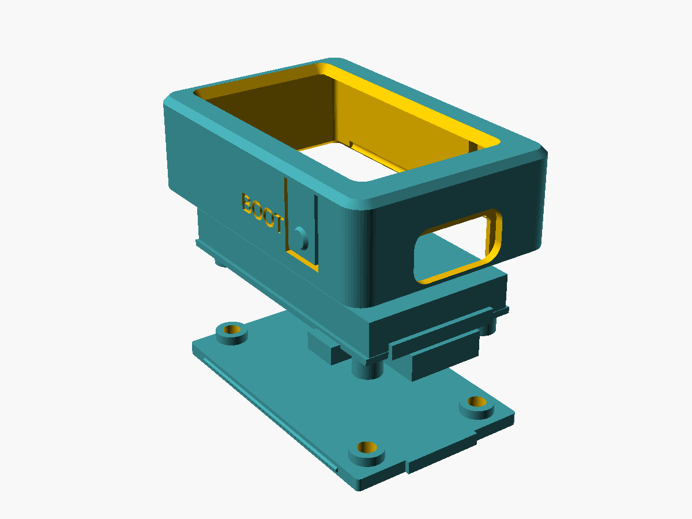

# Buddy housing for the Waveshare ESP32-C6-LCD-1.47

Parametric OpenSCAD source: `buddy_housing.scad`. Ready-made STLs in `stl/`.



## Parts

| Part | File | Print |
|---|---|---|
| Front shell (bezel, walls, USB-C opening, BOOT and RST flex buttons) | `stl/buddy_shell.stl` | Bezel face down, as exported. No supports needed (the USB opening is a short bridge). |
| Back plate (screw bosses, snap beads) | `stl/buddy_plate.stl` | Flat, bosses up. |

PLA or PETG, 0.2 mm layers, 3+ perimeters so the walls are solid.

## Assembly

1. Screw the board onto the back plate with 4x **M2x4 pan-head** screws, through
   the plate into the board's own threaded M2 posts (2 mm of thread engagement;
   M2x5 would hit the bottom of the 2.5 mm posts).
2. Push the board, screen first, into the shell from the back until the plate's
   edge beads click into the grooves. The notch at the top end lets you pry it out.

## Key dimensions (mm)

- Outside: 26.9 x 40.8 x 11.7, 2.5 mm corner radius, 0.8 mm front chamfer.
- Walls 1.6, bezel 1.2, back plate 1.6.
- Screen window: 17.99 x 32.95 (active area 17.39 x 32.35 plus 0.3 per side),
  chamfered 0.9 toward the viewer.
- USB-C: 10.4 x 4.05 hole in the inner skin, open to the back as a slot so the
  connector slides in; a tongue on the back plate closes the slot under it.
  12.0 x 6.4 plug relief 1.0 deep in the outer skin.
- Buttons: 10 x 4 flex tabs in the long walls, thinned to 1.0. The nub sits
  0.10 outside a 1.4 mm button overhang (0.31 off the STEP's 1.19) and has a
  45 degree lead-in, so the buttons slide past while you push the board in.
- Push-in fit: the walls and nubs clear a USB-C and button overhang of 1.4
  (`fit_out`). `board()` with `sweep=30 board_out=1.4` sweeps the board along
  its push-in path; intersecting it with `shell()` comes out empty.
- BOOT is on the left and RST on the right with the screen up and USB-C at the
  bottom (the side was read from Waveshare's photo).

## Board reference (from Waveshare's STEP model and drawing)

Board origin is the PCB's lower-left corner on its top face, USB-C edge at y = 0.

- PCB 20.32 x 36.37 x 0.8. Screen face +4.30 above the PCB top.
- M2 posts (3.5 dia) to z -3.30: (2.00, 2.40), (18.32, 2.40), (3.52, 34.40), (16.80, 34.40).
- USB-C 9.58 wide, from z -4.05 to the PCB back, sticks out 1.21 past the edge.
- Side buttons centred 7.04 from the USB edge, z -1.5, stick out 1.19.
- Active area 17.39 x 32.35 from (1.47, 3.02).

Change any of these at the top of the `.scad` file. The TF slot is not
reachable with the case closed, and the design assumes no pin header.

## Rebuilding

```sh
openscad -D 'part="shell"' -o stl/buddy_shell.stl buddy_housing.scad
openscad -D 'part="plate"' -o stl/buddy_plate.stl buddy_housing.scad
openscad -D 'part="exploded"' buddy_housing.scad   # preview with a board stand-in
```
