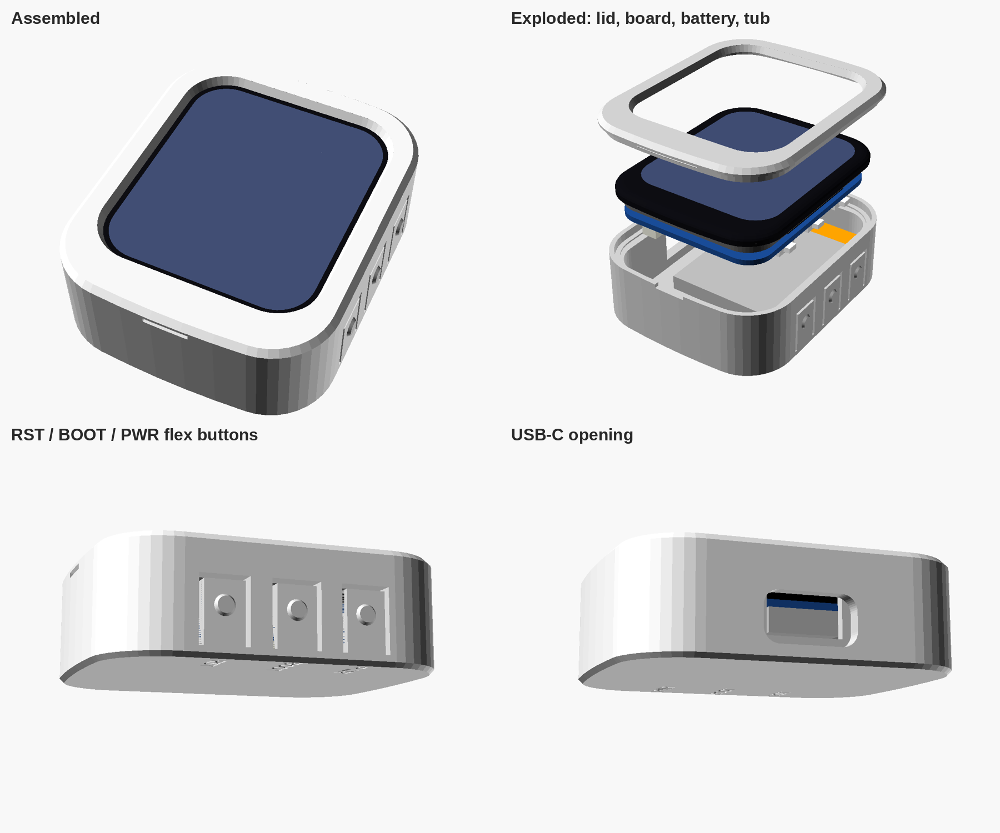

# Buddy housing for the Waveshare ESP32-S3-Touch-LCD-1.69

Parametric OpenSCAD source: `buddy_housing_169.scad` (glass outline in
`glass_outline.scad`). Ready-made STLs in `stl/`. Holds the board plus a
302030 LiPo (3 x 20 x 30) behind it.



## Parts

| Part | File | Print |
|---|---|---|
| Tub (floor with battery bay, walls, USB-C opening, RST/BOOT/PWR flex buttons, glass ledge) | `stl/buddy169_tub.stl` | Floor down, as exported. No supports. |
| Lid (bezel and screen window, skirt with snap beads) | `stl/buddy169_lid.stl` | Face down, as exported. No supports. |

PLA or PETG, 0.2 mm layers (0.1-0.12 helps the 0.75 mm skirt), 3+ perimeters.

## Assembly

1. Stick the battery into the bay on the tub floor (thin double-sided foam
   tape), wires at the PWR-button end.
2. Plug the battery into the board's BAT connector. Tuck the spare lead
   beside the battery, toward the USB-C side.
3. Drop the board in screen up. The cover glass sits on a ledge all round.
4. Press the lid on until the four snap beads click. The notch in the seam at
   the RTC end lets you pry it off again.

## Key dimensions (mm)

- Outside: 37.0 x 45.0 x 14.6. Front edge chamfer 0.8, back 0.6.
- Wall 1.8 outside the glass pocket (0.9 tub lip + 0.15 gap + 0.75 lid skirt).
  Bezel 1.2, floor 1.4.
- Screen window: 28.77 x 33.43 (active area 27.97 x 32.63 plus 0.4 per side),
  R5.4 corners, chamfered 0.9 toward the viewer. The lid underside follows the
  glass's rounded front edge, 0.05 off it.
- Glass pocket: the glass outline sliced from the STEP plus 0.15. The glass
  rests on a ledge at the back of the glass (0.7 to 1.5 wide).
- Battery bay: low ribs on the USB side and the RTC end, the button-side
  wall on the third side, wire end open. 3.3 deep (0.3 spare for foam or
  swelling); the battery's front face is 0.2 behind the tallest part under
  it (the LCD flex connector). The battery spans x -4.4..15.6, which is
  about 2.5 mm further toward the buttons than in the photo: the BAT
  connector's mouth faces the middle of the board, so the plug and its wires
  need room beside the battery.
- USB-C: 12.0 x 6.4 plug relief cut in until it is 0.35 from the receptacle
  face, and a slot through the glass ledge so the receptacle drops in.
- Buttons: three 5.0 wide flex tabs in the `+x` wall, hinged at the floor and
  free toward the screen, thinned to 0.8. Nub tips sit 0.15 off each button,
  with a 45 degree lead-in on the screen side. Labels engraved on the back.

## Board reference (Waveshare STEP `ESP32-S3-Touch-LCD-1_69.stp`)

Origin at the board centre, z = 0 on the back of the LCD panel, `+z` toward
the viewer, USB-C on `-x`, buttons on `+x`, LCD flex at `-y`.

- Cover glass 33.14 x 41.10, z 2.0 to 3.8, rounded front edge.
- LCD panel 30.08 x 37.41, z 0 to 2.0. PCB 29.85 x 37.14 x 1.0, z -2.5 to -1.5.
- Buttons RST / BOOT / PWR at y -9.76 / -0.85 / 8.06, actuator tip x 15.55, z -3.37.
- USB-C face at x -16.24, centred y -0.93, z -4.25, shell 8.95 x 3.1.
- BAT connector (1.25 mm, 2 pin) x -13.92..-8.72, y 4.97..12.62, mouth facing `+x`.
- Deepest parts behind the PCB: RTC connector -6.9, BAT connector -6.0,
  everything under the battery -4.6 or less.

## Fit check

`check/` holds the scripts used to check the design against the STEP
(trimesh, OCP): `step_export.py` meshes the STEP, `fitcheck.py` tests the
board in its rest position and swept 0.5 to 18 mm up along the drop-in path
against the tub and lid, plus the battery box. All came out clear.
`contact.py` confirms the glass sits on the ledge, the lid is 0.05 off the
glass, and the nubs touch the buttons after 0.15 of travel.

## Rebuilding

```sh
openscad -D 'part="tub"' -o stl/buddy169_tub.stl buddy_housing_169.scad
openscad -D 'part="lid"' -o stl/buddy169_lid.stl buddy_housing_169.scad
openscad -D 'part="exploded"' buddy_housing_169.scad   # preview with a board stand-in
```
